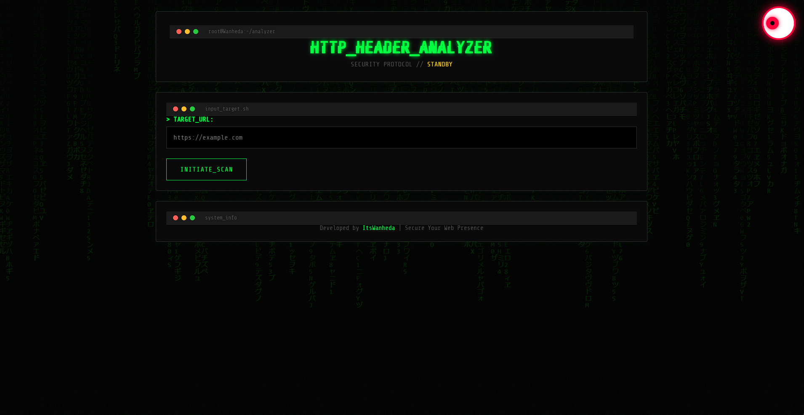
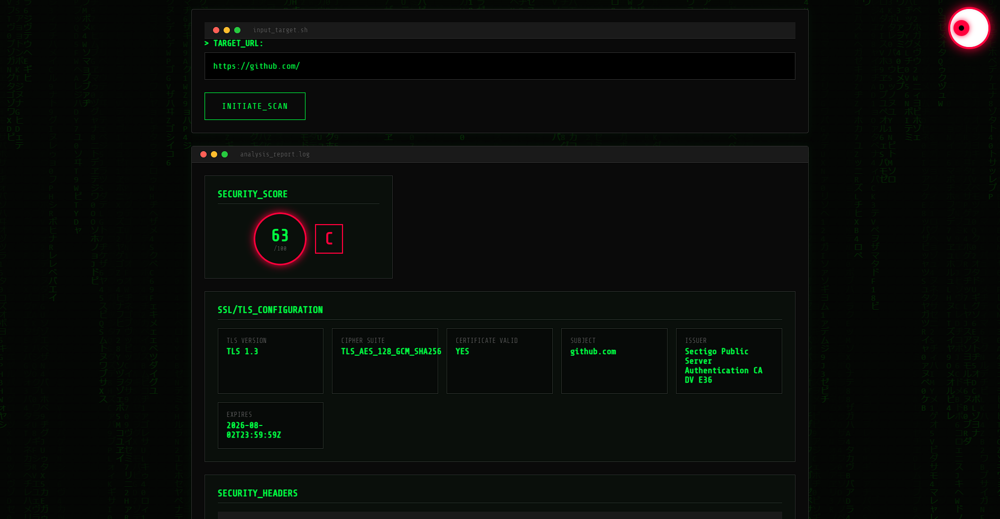
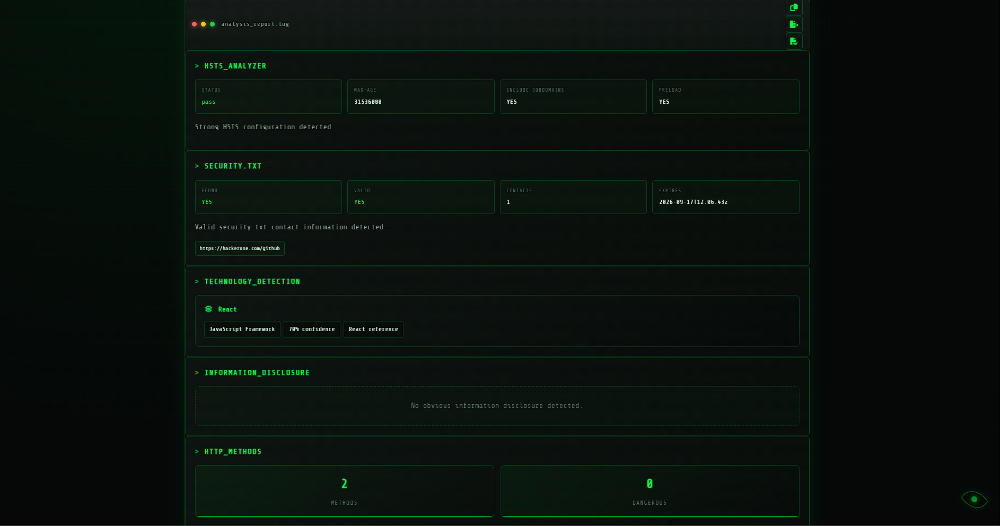
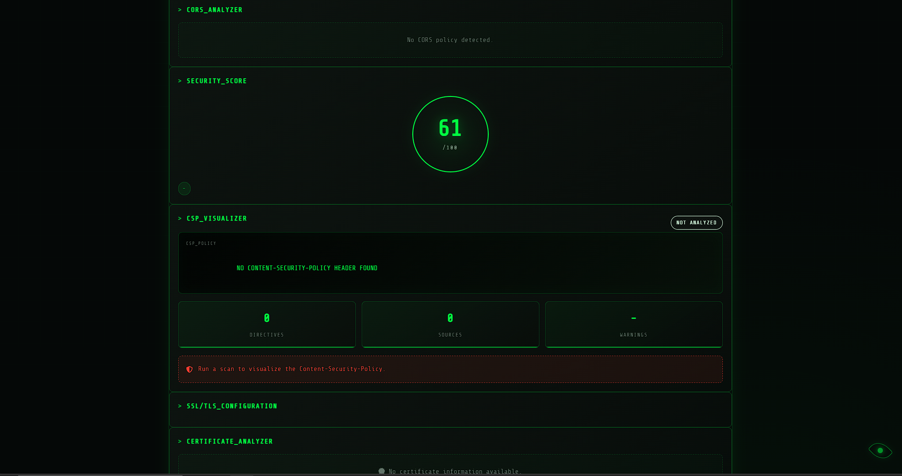

<div align="center">

# 🔐 HTTP Header Analyzer

### V1 Stable Release · `v1.0.0`

**Analyze. Understand. Secure.**

A security-focused HTTP header, TLS, cookie, redirect, and configuration analyzer built with Go. Turn externally observable website security signals into clear findings, meaningful risk scores, and practical remediation guidance.

[](CHANGELOG.md)
[](https://go.dev/)
[](LICENSE)
[](https://github.com/ItsWanheda/http-header-analyzer/actions/workflows/go-ci.yml)
[](https://github.com/ItsWanheda/http-header-analyzer/actions/workflows/browser-e2e.yml)
[](https://github.com/ItsWanheda/http-header-analyzer/actions/workflows/codeql.yml)

</div>

> **V1 release:** `v1.0.0` is the project's first stable V1 release. It brings together hardened target validation, richer security analysis, a responsive dashboard, browser-local history, reporting exports, a bounded batch API, and automated verification.
>
> **Responsible use:** Scan only systems you own or have explicit permission to test.

---

## 🧭 Contents

- [Features](#-features)
- [Screenshots](#-screenshots)
- [How It Works](#-how-it-works)
- [Security Rating](#-security-rating)
- [Quick Start](#-quick-start)
- [CLI Reference](#-cli-reference)
- [REST API](#-rest-api)
- [Security Model](#-security-considerations)
- [Browser-Local History](#-browser-local-scan-history)
- [Project Structure](#-project-structure)
- [Development and Tests](#-development)
- [Roadmap](#-roadmap)
- [Contributing](#-contributing)
- [Security Policy](SECURITY.md)
- [Changelog](CHANGELOG.md)
- [License](#-license)

---

## 🚀 What's Included in V1

| Capability | V1 release |
| --- | --- |
| Security analysis | HTTP security headers, CSP/HSTS policy checks, cookies, TLS certificates, CORS, redirects, `security.txt`, and information-disclosure signals |
| Safe scanning | SSRF-aware validation, DNS destination checks, validated redirect hops, default-port restrictions, and non-mutating `OPTIONS` method discovery |
| Findings and scoring | Evidence-backed findings, severity, practical remediation, and score handling for not-applicable or unknown checks |
| Dashboard | Responsive dark/light interface, executive summary, filtering, sorting, expandable findings, progress feedback, and cancellation |
| Reports and history | JSON and CSV exports, print/save as PDF, browser-local scan history, and finding comparisons |
| API and automation | Single and batch analysis, bounded concurrency, request limits, rate limiting, health check, CLI quality gates, and CI workflows |

---

## ✨ Features

| Area | What it does |
| --- | --- |
| 🛡️ Security headers | Checks CSP, HSTS, X-Frame-Options, X-Content-Type-Options, Referrer-Policy, Permissions-Policy, and related controls |
| 🍪 Cookie security | Reviews `Secure`, `HttpOnly`, and `SameSite` protections |
| 🔐 TLS inspection | Reports protocol, cipher, certificate, issuer, subject, and expiration details |
| 🔀 Redirect analysis | Records each redirect hop with bounded, individually validated requests |
| 📊 Security scoring | Scores evaluated checks only, excludes not-applicable/unknown checks, and provides a 0–100 rating or N/A when no evidence can be scored |
| 🧠 Remediation | Provides explanations, observed evidence, and practical recommendations for findings |
| 🛑 SSRF defenses | Rejects local/reserved hostnames, special-use/private IP ranges, mixed public/private DNS answers, non-default ports, and unsafe redirect destinations |
| 🔎 Extended analysis | Detects technologies, origin-aware CORS behavior, safely advertised HTTP methods, `security.txt`, robots.txt, CSP risks, and information disclosure signals |
| ⚡ REST API | JSON single and batch analysis endpoints, bounded scan concurrency, per-client rate limiting, and a health-check endpoint |
| 🎨 Web dashboard | Responsive dark/light dashboard with an executive summary, severity counters, finding search/sort/expand controls, cancelable scans, and JSON/CSV/print-to-PDF exports |

## 📸 Screenshots

| Dashboard | Analysis | Findings |
| --- | --- | --- |
|  |  |  |



---

## 🧭 How It Works

```text
Target URL
    │
    ▼
Validate URL and apply SSRF protections
    │
    ▼
Fetch response and inspect headers, individual cookies, TLS/certificate metadata, and redirect hops
    │
    ▼
Run safe OPTIONS/CORS preflight checks, parse CSP policy risks, inspect robots.txt and security.txt, and collect evidence
    │
    ▼
Calculate score and generate remediation guidance
    │
    ▼
Display results in the dashboard or return JSON
```

## 📊 Security Rating

The analyzer reports a score between 0 and 100 and maps it to the following rating bands when applicable. Checks marked not applicable or unknown do not earn points or reduce the denominator. If no checks can be scored, the result is `N/A`, not an artificial zero or a passing grade.

| Score | Rating |
| ---: | :---: |
| 97–100 | A+ |
| 93–96 | A |
| 90–92 | A- |
| 87–89 | B+ |
| 83–86 | B |
| 80–82 | B- |
| 77–79 | C+ |
| 73–76 | C |
| 70–72 | C- |
| 60–69 | D |
| 0–59 | F |

---

## ⚡ Quick start

### Requirements

- Go 1.21 or newer
- Git

### Install

```bash
git clone https://github.com/ItsWanheda/http-header-analyzer.git
cd http-header-analyzer
go mod download
```

### Run the web application

```bash
go run ./cmd/server
```

Then open <http://localhost:8080>.

### Use the CLI

Build the scanner CLI:

```bash
go build -o http-header-analyzer ./cmd/http-header-analyzer
```

Scan a target with human-readable output:

```bash
./http-header-analyzer scan https://example.com
```

Return the complete analysis as machine-readable JSON:

```bash
./http-header-analyzer scan https://example.com --json
```

Save JSON directly to a file:

```bash
./http-header-analyzer scan https://example.com --json --output report.json
```

Control the maximum scan duration:

```bash
./http-header-analyzer scan --json --timeout 30s https://example.com
```

Use quality gates in CI/CD:

```bash
# Fail when the score is below 80
./http-header-analyzer scan --min-score 80 https://example.com

# Fail when a High-or-worse issue exists
./http-header-analyzer scan --fail-on high https://example.com

# Combine both checks
./http-header-analyzer scan --json --min-score 80 --fail-on high https://example.com
```

The CLI exits with a non-zero status when a scan cannot be completed, making it suitable for scripts and CI pipelines. By default, web scans use safe discovery only: HTTP method analysis issues OPTIONS and reads the Allow header rather than sending state-changing methods.

### 🔎 Verify the CLI version

The V1 CLI reports the application release version locally; no target is contacted.

```bash
./http-header-analyzer version
# 1.0.0

# Equivalent flag:
./http-header-analyzer --version
```

### Build a production binary

```bash
go build -o http-header-analyzer ./cmd/server
./http-header-analyzer
```

On Windows:

```powershell
go build -o http-header-analyzer.exe ./cmd/server
.\http-header-analyzer.exe
```

---

## ⚙️ REST API

### Analyze a target

```http
POST /api/analyze
Content-Type: application/json
```

Request:

```json
{
  "url": "https://example.com"
}
```

Example response shape:

```json
{
  "url": "https://example.com",
  "score": 95,
  "rating": "A",
  "issues": [
    {
      "header": "Strict-Transport-Security",
      "status": "fail",
      "severity": "High",
      "explanation": "HSTS helps prevent protocol downgrade attacks.",
      "remediation": "Add Strict-Transport-Security with an appropriate max-age."
    }
  ]
}
```

### Batch analysis

```http
POST /api/analyze/batch
Content-Type: application/json
```

Request:

```json
{
  "urls": [
    "https://example.com",
    "https://example.org"
  ]
}
```

The endpoint accepts **1–10 targets per request**, validates every URL before starting work, and limits batch parallelism to three workers while sharing a four-scan process-wide concurrency cap. Individual failures are returned alongside successful results. API requests are also rate-limited per client IP; health checks are exempt. These in-process limits protect a single server instance, so multi-instance deployments should add edge-level rate limits and network egress controls.

### Health check

```http
GET /api/health
```

```json
{
  "status": "healthy"
}
```

---

## 🛡️ Security Considerations

Because the application makes outbound requests to user-supplied URLs, URL validation is a core security boundary. The validation layer:

- Accepts only `http` and `https` URLs.
- Rejects embedded credentials and URL fragments.
- Rejects localhost and local hostnames.
- Rejects private, loopback, link-local, multicast, and unspecified IP literals.
- Restricts requests to the default port for the selected scheme (HTTP 80 or HTTPS 443).
- Rejects special-use and documentation IP ranges and rejects hostnames with local/reserved suffixes.
- Resolves hostnames at connection time and rejects mixed public/private address answers; outbound proxy environment variables are not used so proxy DNS cannot bypass destination checks.
- Uses only OPTIONS for HTTP-method discovery; it does not send POST, PUT, PATCH, DELETE, TRACE, or CONNECT as probes.
- Bounds API request sizes, per-client rate, scan concurrency, batch target count, and per-scan duration.
- Limits request-body sizes and validates JSON API input.

These controls reduce risk but do not replace network-level egress controls, authentication, authorization, or responsible operation. The public scanning API does not provide user identity or tenant isolation; run it behind authentication or trusted network controls if it is not intended for anonymous use. The built-in rate limiter is process-local and does not coordinate across replicas. Deploy the service behind appropriate infrastructure controls in production.

See [SECURITY.md](SECURITY.md) for reporting security issues.

---

## 🏗️ Project structure

```text
http-header-analyzer/
├── cmd/
│   └── server/
│       └── main.go              # HTTP server and route registration
├── internal/
│   ├── analyzer/                # Header, CSP, TLS, certificate, redirect, and extended analysis
│   ├── api/                     # HTTP handlers, batch API, rate limiting, and JSON responses
│   ├── models/                  # Analysis result types
│   └── validation/              # URL, port, and SSRF-aware destination validation
├── tests/                       # Playwright dashboard smoke tests
├── web/
│   ├── templates/               # HTML templates
│   └── static/                  # JavaScript and CSS assets
├── assets/                      # Screenshots and project media
├── go.mod
├── go.sum
└── README.md
```

### Browser-Local Scan History

The dashboard keeps the most recent 20 structured scan results in the current browser's `localStorage`. It shows new, resolved, and unchanged findings when another scan of the same hostname is run. This is intentionally client-local and privacy-preserving; it is not a shared server-side history and clearing browser storage removes it. Export JSON/CSV or print the report to retain a durable copy.

## 🧪 Development and Tests

Format the Go code:

```bash
gofmt -w cmd internal
```

Run the test suite:

```bash
go test ./...
```

Run tests with verbose output:

```bash
go test -v ./...
```

Run static analysis and build all packages:

```bash
go vet ./...
go build ./...
go mod verify
```

The GitHub Actions pipeline also runs the race detector, a Go vulnerability scan with `govulncheck`, and a Playwright Chromium smoke suite for dashboard behavior.

---

## 🤝 Contributing

Contributions, bug reports, documentation improvements, and security enhancements are welcome.

1. Fork the repository.
2. Create a focused branch:
   ```bash
   git checkout -b feature/my-improvement
   ```
3. Make your changes and add tests where appropriate.
4. Run `gofmt`, `go test ./...`, `go vet ./...`, and `go build ./...`.
5. Commit using a clear Conventional Commit message.
6. Push your branch and open a pull request.

Please read [CONTRIBUTING.md](CONTRIBUTING.md) before submitting changes.

## 🗺️ Roadmap

- [x] JSON analysis reports
- [x] CSV and PDF report support
- [x] CSP visualization
- [x] TLS, cookie, redirect, CORS, and `security.txt` checks
- [x] Browser-local scan history (up to 20 saved scans)
- [x] Result comparison and new/resolved finding regression detection
- [x] Batch URL scanning with bounded concurrency (up to 10 targets per request)
- [ ] Subdomain analysis
- [x] Expanded CSP policy analysis with structured warnings

## 📄 License

This project is distributed under the [MIT License](LICENSE).

## 👤 Author

Created and maintained by [ItsWanheda](https://github.com/ItsWanheda).

If you find the project useful, consider giving it a ⭐ and sharing feedback through [issues](https://github.com/ItsWanheda/http-header-analyzer/issues) or [discussions](https://github.com/ItsWanheda/http-header-analyzer/discussions).

---

<div align="center">

**Analyze. Understand. Secure.**

Made with ❤️ and Go by [ItsWanheda](https://github.com/ItsWanheda)

</div>